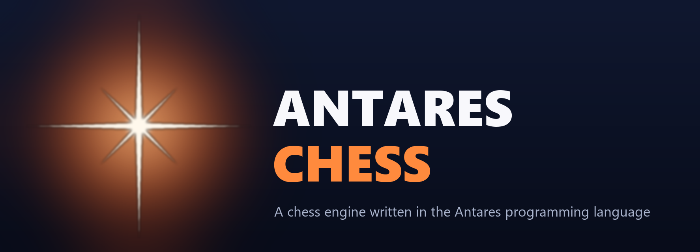

# Antares Chess



A UCI chess engine written in [Antares](https://github.com/Madushan996/Antares-Programming-Language), my own programming language. It began as a port of my C++ engine NARC Genesys 5.1 and is now an engine of its own: everything in it is Antares code, compiled to a native program by `antares build`.

It searches with bitboards, magic move generation and a full modern search, and evaluates with a neural network (the mixed249m twin-lane network, trained for the NARC Genesys development engine: 16 king buckets and 1024 hidden units, 768 of them shared across king buckets).

## Download

Ready-to-run engines are attached to the [releases](https://github.com/Madushan996/Antares_Chess/releases). Each is one self-contained file with the network inside. Add it to a chess GUI (Arena, Cute Chess, Banksia, En Croissant...) as a UCI engine. It announces itself as **Antares Chess**.

| File | For |
|---|---|
| `Antares-Chess-avx2.exe` | Processors with AVX2 (2013 and later). **Use this one if it runs.** |
| `Antares-Chess-sse42.exe` | Processors with SSE4.2 (2009 and later) |
| `Antares-Chess-generic.exe` | Any 64-bit PC |
| `Antares-Chess-native.exe` | Built for the development laptop (Intel Skylake); may not start on other processors |

The `.bmp` with the same name is the engine's 100 x 50 logo for Arena (put it next to the `.exe`).

## Using it

UCI commands: `uci`, `isready`, `ucinewgame`, `position`, `go` (`depth`, `nodes`, `movetime`, `wtime`/`btime`/`winc`/`binc`/`movestogo`, `infinite`), `stop`, `quit`, plus `d` (show the board), `eval` and `perft N`.

| Option | Default | What it does |
|---|---|---|
| `Hash` | 64 | Transposition table size in MB (1 to 256) |
| `Move Overhead` | 80 | Milliseconds kept back from the clock for the GUI's delays |
| `EvalFile` | (embedded) | Load another network file instead (the twin-lane DRNNUE04 format, or the single-lane DRNNUE03 format of the Genesys 5.1 network) |

One thread only.

## Speed

Search to depth 13 after 1. e4 e5, best of six runs on the development laptop (Intel Core i7-6600U), all measured in the same session with the same network:

| Engine | Positions searched | Positions per second | Time to depth 13 |
|---|---:|---:|---:|
| **Antares Chess 1.0, avx2** | 184,714 | 535,000 | 0.35 s |
| **Antares Chess 1.0, native** | 184,714 | 534,000 | 0.35 s |
| NARC Antares 2.1, native (the version before) | 214,964 | 567,000 | 0.38 s |
| C++ NARC Genesys development build | 170,730 | 1,138,000 | 0.15 s |

The new transposition table keeps more of what the search has found, so the engine needs 14% fewer positions to reach the same depth. It is about 6% slower per position, because a 64 MB table fits the processor's caches less well than the old 12 MB one. Overall it reaches depth 13 about 9% sooner.

## Strength

`tools/match.py` plays two engines against each other on real clocks, from 400 level openings (each played with both colours), and gives the Elo difference with its error margin:

```bash
python tools/match.py NEW.exe OLD.exe --games 300 --tc 8+0.08
```

Against NARC Antares 2.1 at 8 seconds + 0.08 per move, Antares Chess 1.0 scored 24 wins, 67 draws and 29 losses (120 games): **equal within the margin** (Elo −14, 95% range −56 to +27). At such short games the old table rarely filled up; the bucketed table with ageing is for longer games, where it has to choose what to keep.

## Building

```bash
python build.py            # all four binaries, into builds/
python build.py avx2       # just one
```

Needs Antares 0.4.0 or later (0.5.0 recommended) and Rust. The board state and the move-generation functions have ranges (`within`), so the compiled engine needs no position checks there. `python tools/make_logo.py` redraws the logo files.

To run the engine without compiling: `antares src/antares_chess.ant`

## The book

[**Inside Antares Chess**](docs/Inside_Antares_Chess.pdf) is a beginner's guide to this engine's code: how a chess engine works, line by line, and the Antares language it is written in. Every listing is read from `src/` when the book is built, and every example is run:

```bash
python docs/src/check_examples.py     # runs the book's examples
python docs/src/build.py              # builds docs/Inside_Antares_Chess.pdf
```

## Inside

- **Board:** bitboards, magic bitboards for sliding pieces (with the C++ engine's magic numbers), exchange evaluation (SEE).
- **Evaluation:** the network, with accumulators kept in one compact matrix and updated incrementally and lazily, and a king-bucket cache.
- **Search:**
  - iterative deepening with aspiration windows, principal variation search and quiescence search;
  - a transposition table of 4-entry buckets with ageing;
  - pruning: mate-distance, reverse futility, razoring, null move, late move, futility, history and SEE;
  - internal iterative reduction and late-move reductions;
  - check extensions, and singular extensions with multi-cut.
- **Move ordering:** killers, counter moves, threat-split quiet history, continuation history (1 and 2 plies back), capture history.
- **Evaluation corrections:** pawn, non-pawn, minor-piece and continuation correction histories.
- **Time management:** scaled by how stable the best move is, how the score is moving, and how much of the search went to the best move.

## Layout

| Path | What it holds |
|---|---|
| `src/board.ant` | Bitboards and attack tables, the position, making and taking back moves, move generation, SEE, FEN, perft |
| `src/nnue.ant` | Loading the network, the incremental accumulators, evaluation |
| `src/search.ant` | The search, the transposition table, move ordering and the histories |
| `src/antares_chess.ant` | The UCI front end and time management |
| `src/config.ant` | Finds the network: the embedded copy in a binary, otherwise the file |
| `networks/antares-chess.nnue` | The network |
| `tools/` | `match.py` (engine matches), `make_openings.py` and `openings.txt`, `make_logo.py` |
| `tests/` | Tests and timing tools |
| `docs/` | The book *Inside Antares Chess* and its sources |
| `archive/` | Earlier versions (array board; bitboard engine with the Genesys 5.1 network) |
| `build.py` | Builds the binaries |

## Tests

| Command | What it checks |
|---|---|
| `antares tests/test_perft.ant` | Move generation: 11 perft counts on 6 standard positions |
| `antares tests/test_eval.ant` | The evaluation equals the C++ NARC Genesys engine's on 6 positions, and the incremental update equals a full one after every move of three games |
| `python tests/uci_driver.py tactics` | Mates in 1, 2 and 3 found at the right length, with the C++ engine as referee |
| `python tests/uci_driver.py selfplay 150 140` | A long game against itself, every move checked for legality by the C++ engine |

Set `ANTARES_CHESS_BINARY=avx2` (or another variant) to run the Python tests against a binary instead of the interpreted engine. They expect the C++ engine at `Documents/NARC_ChessEngine/builds/NARC-Genesys-5.1/NARC-Genesys-5.1-generic.exe`.

## History

| Version | What it was |
|---|---|
| Antares Chess 1.0 | The new name, a bucketed transposition table with a `Hash` option, the match tools |
| NARC Antares 2.1 | Built with Antares 0.4.0 (ranges): move generation 35 to 54% faster |
| NARC Antares 2.0 | The twin-lane network, compact accumulators, magic bitboards, the king-bucket cache |
| NARC Genesys 5.1 Antares Edition 1.0 | The first port of the C++ engine, with the Genesys 5.1 network |

## Licence

GPL v3, the same as NARC Genesys (see `LICENSE`).
