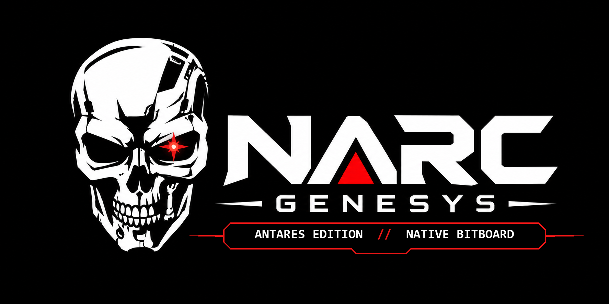

# NARC Genesys 5.1 in Antares



The NARC Genesys 5.1 chess engine (C++, by Madushan Dissanayake) re-written in
the Antares language. It is a working UCI engine that uses the real Genesys 5.1
network and searches the same way as the original.

The original C++ engine lives in `Documents/NARC_ChessEngine` on the
development machine; nothing there is changed or needed at run time. The
Antares language is at
[Madushan996/Antares-Programming-Language](https://github.com/Madushan996/Antares-Programming-Language)
(`Documents/Antares` on the development machine).

## Binaries

Ready-to-run engines are attached to the
[GitHub releases](https://github.com/Madushan996/NARC-Antares/releases)
(`python build.py` puts them in `builds/`). There are two generations:

| Files | What they are |
|---|---|
| `NARC-Genesys-5.1-Antares-bitboard-*.exe` | The current engine: bitboards, about 360,000 to 400,000 positions per second |
| `NARC-Genesys-5.1-Antares-*.exe` (no "bitboard") | The earlier array-board engine, about 145,000 to 210,000 per second. Kept because it may be installed in a chess GUI; its source is no longer in `src/` |

The bitboard binaries before this build (made with Antares 0.1.0, about 250,000
positions per second) are kept in `archive/bitboard-antares-0.1/`, with the
README that described them.

Each comes in four variants:

| Ending | For |
|---|---|
| `-avx2.exe` | Processors with AVX2 (2013 and later). Use this one if it runs. |
| `-sse42.exe` | Processors with SSE4.2 (2009 and later) |
| `-generic.exe` | Any 64-bit PC |
| `-native.exe` | Built for exactly the machine that compiled it |

Add one to a chess GUI as a UCI engine, or run it and type UCI commands
(`uci`, `isready`, `position startpos moves e2e4`, `go depth 10`,
`go movetime 2000`, `go wtime 60000 btime 60000`, `stop`, `quit`) or the
extras `d` (show the board), `eval` and `perft 4`. The bitboard engine
announces itself as "NARC Genesys 5.1 (Antares, bitboard)".

The bitboard binaries have the network embedded (about 26 MB each), so each
one is a single self-contained file: copy it anywhere and it runs. The UCI
option `EvalFile` loads a different network file instead.

The `.bmp` next to each bitboard binary is its logo for Arena (100 x 50); the
banner, icon and `.ico` of the Antares Edition logo are in `builds/logo/`.

The earlier array-board binaries (about 1 MB) do not carry the network. They
look for `narc-genesys.nnue` next to themselves, then in a `networks` folder
beside or above them, so they work from `builds/` as they are.

To rebuild the bitboard binaries (needs the `antares` command and Rust):

```bash
python build.py
```

The current binaries were built with the faster compiler that will come with
the next Antares release. Building with Antares 0.1.0 gives the same engine
(the same searches, move for move) at the earlier speed.

## Speed

Same position (after 1. e4 e5), search to depth 13, best of six runs on the
development laptop, all engines measured in the same session:

| Engine | Positions searched | Positions per second |
|---|---|---|
| Antares bitboard, current binaries | 237,721 | 362,000 (sse42) to 400,000 (native) |
| Antares bitboard, previous binaries (Antares 0.1.0) | 237,721 | 249,000 to 259,000 |
| Antares array board, avx2 (earlier version) | 153,756 | 212,000 (earlier measurement) |
| Antares bitboard, interpreted | 237,721 | about 4,000 |
| Original C++, generic build | 251,654 | 395,000 |
| Original C++, avx2 build | 251,654 | 936,000 |

The current bitboard binaries are about 1.5 times as fast as the previous
ones and run at about 95% of the speed of the C++ generic build, while
searching fewer positions to reach the same depth; they reach about 40% of the
C++ avx2 build. Timings on this laptop vary by tens of percent from run to run
(an earlier, cooler measurement had the C++ builds at 490,000 and 1,160,000),
and more when a chess GUI is running engines at the same time.

What still separates it from the original:

- **The network.** About a quarter of the time goes to updating the
  accumulators, and another tenth to passing them between the engine and the
  language runtime as general values. A king move rebuilds that side's
  accumulator from scratch, where the C++ engine uses a king-bucket cache.
- **Checks the C++ does not make.** Array accesses are still checked to be in
  range (most tables are now fixed-size arrays, so the check is against a
  constant and arrays are no longer checked for sharing), and most functions
  still report problems through a result value.
- **Sliding-piece attacks.** Found by cutting rays at the first blocker with a
  bit scan (four lookups per piece) instead of one magic or PEXT lookup.

`antares build tests/profile.ant` and `tests/profile_eval.ant` time each
building block.

## Layout

| Path | What it holds |
|---|---|
| `src/board.ant` | Bitboards and attack tables, the position, making and taking back moves, move generation, exchange evaluation (SEE), FEN, perft. Ports `position.cpp`, `movegen.cpp`, `bitboard.cpp`, `perft.cpp` |
| `src/nnue.ant` | Loading the network; incremental accumulators; evaluation. Ports `nnue.cpp` |
| `src/search.ant` | The search and everything it learns while searching. Ports `search.cpp`, `movepick.cpp`, `tt.cpp`, `history.h` |
| `src/narc.ant` | The UCI front end and time management. Ports `uci.cpp`, `main.cpp` |
| `src/config.ant` | Finds the network: the embedded copy in a binary, otherwise the file |
| `networks/narc-genesys.nnue` | The Genesys 5.1 network (a copy of the original's); embedded into the binaries by `build.py`, read directly when running interpreted |
| `builds/` | The binaries |
| `archive/array-board/` | The earlier array-board version: its binaries and its `nnue.ant`, `search.ant`, `narc.ant` (its `board.ant` was not kept) |
| `build.py` | Builds the binaries |
| `tests/` | Tests and the timing breakdown |

To run the engine without compiling:

```bash
antares src/narc.ant
```

## Tests

| Command | What it checks |
|---|---|
| `antares tests/test_perft.ant` | Move generation: 11 perft counts on 6 standard positions |
| `antares tests/test_eval.ant` | Evaluation equals the C++ engine's `eval` output on 6 positions, and the incremental update equals a from-scratch evaluation after every move of three games (castling, en passant, promotions, king walks) |
| `python tests/uci_driver.py tactics` | With the C++ engine as reference: forced mates in 1, 2 and 3 found with the same length; other moves are the reference's choice or rated as good |
| `python tests/uci_driver.py selfplay 150 140` | A 140-move game against itself, every move checked for legality by the C++ engine |

Set `NARC_BINARY=avx2` (or `generic`, `sse42`, `native`) to run the two Python
tests against a binary instead of the interpreted engine. They expect the
original C++ build at
`Documents/NARC_ChessEngine/builds/NARC-Genesys-5.1/NARC-Genesys-5.1-generic.exe`.

All of these pass, interpreted and on the bitboard binaries. The interpreted
engine and every binary search exactly the same positions (237,721 at depth 13
above; 8,131 at depth 8). A 93-move game against the C++ engine, refereed by
it, had no illegal moves.

## What is the same as the C++ engine

The search features that are on by default in 5.1, with the 5.1 constants:
iterative deepening with aspiration windows, principal variation search,
quiescence search, transposition table, mate-distance pruning, reverse
futility pruning, razoring, null-move pruning, internal iterative reduction,
late-move, futility, history and SEE pruning, late-move reductions, check and
singular extensions with multi-cut, killers, counter moves, threat-split quiet
history, continuation history, capture history, the four correction histories,
the time manager with its stability / score-trend / node-share scaling, and
the 5.1 repetition rule. The evaluation is the same network with the same
arithmetic, updated incrementally and lazily as in the original.

## What is different

- **Move generation:** bitboards as in the original, but moves are generated
  without regard to pins and checked for legality by playing them, and
  sliding attacks come from ray tables and bit scans, not magic bitboards.
- **Evaluation:** a king move rebuilds that side's accumulator; there is no
  king-bucket cache.
- **Move ordering:** staged as in the original (hash move, captures, then
  quiet moves only if still needed), but killers and the counter move are
  ordered among the quiet moves by score instead of having their own stages.
- **Transposition table:** one entry per slot (262,144 slots), always
  replaced, instead of three-entry buckets with ageing. No `Hash` option.
- **One thread only.** No `Threads` option.
- **Not ported:** the features that are off by default in 5.1 (ProbCut, TT-PV,
  fifty-move damping, quiescence evasion pruning, the double-extension cap,
  doubt, root watch, four-ply continuation history), and the tools
  (`bench`, `datagen`, `relabel`, `nnuecheck`, `legalcheck`, tuning options).
- **Stopping:** the clock and the GUI are checked every 128 positions, so
  `Move Overhead` defaults to 80 ms instead of 10.

## Licence

GPL v3, the same as the original engine (see `LICENSE`).
